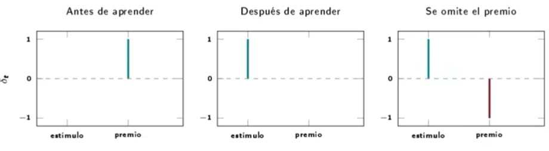
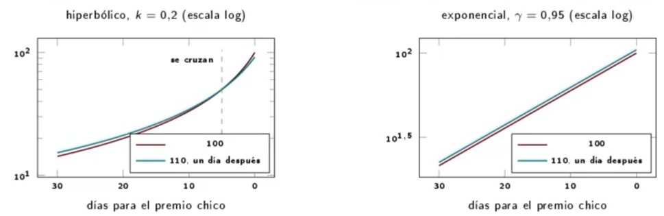

# Ejercicio 12

**Enunciado.** Investigar la aplicacion de conceptos de aprendizaje por refuerzo a la modelacion del comportamiento humano y animal.

## Respuesta

El aprendizaje por refuerzo es un enfoque que permite estudiar cómo los seres humanos y los animales aprenden a tomar decisiones mediante la interacción con su entorno. Se basa en un proceso de prueba y error, en el que los individuos reciben recompensas o castigos dependiendo de las acciones que realizan.

Este modelo busca explicar cómo los organismos modifican su comportamiento a partir de experiencias previas, cómo aprenden a elegir las acciones más beneficiosas y cómo se adaptan a diferentes situaciones.

En los seres humanos, el aprendizaje por refuerzo puede aplicarse al estudio de la toma de decisiones, la formación de hábitos, la motivación y los procesos de aprendizaje. En los animales, permite comprender cómo desarrollan conductas para conseguir alimento, evitar peligros y adaptarse a su ambiente.

En conclusión, el aprendizaje por refuerzo es una herramienta importante para modelar y comprender el comportamiento humano y animal, ya que permite analizar cómo las experiencias, las recompensas y las consecuencias influyen en el aprendizaje y la toma de decisiones.

## Desarrollo

Es investigacion abierta. Vamos a separar

| Firme                                                                             |
| --------------------------------------------------------------------------------- |
| Aprender del error de prediccion, bloqueo, respuesta dopaminergica como errot TD. |

| Hipotesis                                                   |
| ----------------------------------------------------------- |
| Exploracion en la infancia, modelos de adiccion y depresion |

La idea: se aprende de la sorpresa

No aprendemos de lo que pasa, sino de la diferencia entre lo que paso y lo que esperabamos.

Ejemplo:

| Esperabas | Sacaste | ¿Aprendes algo?                             |
| --------- | ------- | ------------------------------------------- |
| 10        | 10      | No: ya lo sabias                            |
| 6         | 10      | Si: sorpresa positiva, subes tu expectativa |
| 10        | 6       | Si: sorpresa negativa, bajas tu expectativa |

error de prediccion = lo que paso - lo que esperaba

Esta misma idea aparece en experimentos con animales y en la actividad de las neuronas de dopamina.

Algoritmo: Rescorla-Wagner y el bloqueo

$\nabla V_{B} = \alpha \beta(\lambda - V_{A} - V_{B}) = \alpha \beta(\lambda - \lambda - 0) = 0$.

- B no aprende nada, aunque aparezca junto con el refuerzo una y otra vez (Kamin, 1969).
- Se aprende del error de prediccion, no del premio.

Diferencias temporales:

$\delta _{t} = r_{t+1} + \gamma V(s_{t+1}) - V(s_{t})$, $V(s_{t})  \leftarrow  V(S_{t}) + \alpha \delta _{t}$.

_Nota: Esta es la formula que el material atribuye a Q-learning y SARSA. Es TD(0) para V: aquellas usan $Q: \delta ^{Q} = r + \lambda max_{a'} Q(s', a') - Q(s, a)$\_.

El modelo TD reproduce 3 casos

Simulacion muestra: un estado por instante desde el estimulo, $\alpha = 0.15, \lambda = 1, 400$ ensayos.

El material dice: _Si un animal espera una recompensa y la recibe, la dopamina se dispara_

Lo observado es: _Si esta totalmente predicha, no hay cambio al recibirla. El disparo se traslada al estimulo que la anuncia_.

- Es justo lo que hace que sea un error: si estaba predicha, no hay error que señalar.
- La palabra justa no es 'identico' sino correspondencia cuantitativa notable. Hay refinamientos: por ejemplo, distintas neuronas parecen codificar distintas partes de la distribucion del valor (Dabney et al., 2020).

Comparativa de graficas

- Exponencial: el cociente es $(A_{2} / A_{1})\gamma ^{\Delta}$, no depende de D. Las curvas nun se cruzan.
- Hiperbolico (lo que se observa; Ainslie 1975, Mazur 1987): se cruzan. Desde lejos esperas; de cerca, tomas lo inmediato.
- $\delta$ captura la impaciencia, no la inconsistencia temporal de la conducta impulsiva.

**Resumen**

| Concepto de RL      | Correlato                          | Que permite modelar                               |
| ------------------- | ---------------------------------- | ------------------------------------------------- |
| Recompensa r        | Refuerzo, valor subjetivo          | Motivacion, sensibilidad a la recompensa          |
| Error $\delta _{t}$ | Disparo fasico dopaminergico       | Transferencia al estimulo, bloque, omision        |
| Valor V, Q          | Expectativa aprendida              | Preferencias, persistencia, extincion             |
| Descuento           | Impaciencia (mas bien hiperbolica) | Eleccion intertemporal, inversion de preferencias |
| Con / sin modelo    | Metas / habitos                    | Aprendizaje latente, tarea de dos etapas          |
| Exploracion         | Novedad, juego, curiosidad         | Diferencias entre edades (hipotesis)              |

Se quito '$Agente \iff neurona$': una neurona no elige acciones. Y estos modelos ajustan bien patrones promedio: predecir a un individuo ensayo por ensayo es modesto.

## Referencias

- Russell, S. J., & Norvig, P. (2021). _Artificial Intelligence: A modern approach_, 4th ed., Pearson.
