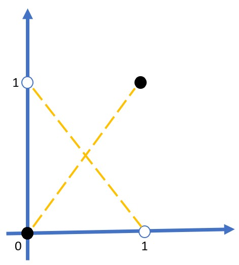

# Ejercicio 8.1

**Enunciado.**
Proporciona los pesos y la estructura de una red neuronal con una función de activación de salida sigmoide y una capa oculta con activación ReLU, que pueda representar la función OR exclusivo (⊕) de dos booleanos. Esta función es verdadera cuando las entradas tienen valores de verdad distintos. Asume que "verdadero" se representa como 1 y "falso" como 0.
[Pista: Escribe el OR exclusivo en términos de otros operadores lógicos. Considera cuántas unidades deben estar en la capa oculta.]

## Respuesta

Dos neuronas ocultas ReLU y una salida sigmoide:  
$h_{1} = ReLU (x_{1} - x_{2})$, $h_{2} = ReLU (x_{2} - x_{1})$, $y = \sigma (v^Th + c) = \sigma (10h_{1} + 10h_{2} - 5)$

En su forma matricial, con $h = ReLU(Wx + h)$ y $y = \sigma(v^Th + c)$:

$
W = \begin{pmatrix}
  1 & -1 \\
  -1 & 1
  \end{pmatrix}
$,
$
b = \begin{pmatrix}
  0 \\
  0
  \end{pmatrix}
$,
$
v = \begin{pmatrix}
  10 \\
  10
 \end{pmatrix}
$, c = -5

### Verificacion

| $x_{1}$ | $x_{2}$ | $h_{1}$ | $h_{2}$ | $z$ |  $y$  | $x_{1} ⊕ x_{2}$ |
| :-----: | :-----: | :-----: | :-----: | :-: | :---: | :-------------: |
|    0    |    0    |    0    |    0    | -5  | 0.007 |        0        |
|    0    |    1    |    0    |    1    |  5  | 0.993 |        1        |
|    1    |    0    |    1    |    0    |  5  | 0.993 |        1        |
|    1    |    1    |    0    |    0    | -5  | 0.007 |        0        |

## Desarrollo

> Metodo 1:

### Tabla

| $x_{1}$ | $x_{2}$ | $x_{1} ⊕ x_{2}$ |
| ------- | ------- | --------------- |
| 0       | 0       | 0               |
| 0       | 1       | 1               |
| 1       | 0       | 1               |
| 1       | 1       | 0               |

Neurona: $z = w_{1}x_{1} + w_{2}x_{2} + b$ \
Activacion: ReLU(z) = $max\{0,z\}$ \
$\sigma (z) = \frac{1}{1 + e^{-z}}$ con su s \
$\sigma (0) = \frac{1}{2}$, \
$\sigma (+5) \approx 0.993$, \
$\sigma (-5) \approx 0.006$



**Proposicion:**  
No existen $w_{1}, w_{2}, t$, tales que $L(x) = w_{1}x_{1} + w_{2}x_{2} + b \ge t$, con exactamente $x_{1} ⊕ x_{2} = 1$. \

demostracion:

```math
\begin{aligned}
  L(1,0) + L(0,1) &= (w_{1} + b_{0}) + (w_{2} + b_{0}) \\
                  &= w_{1} + w_{2} + 2b_{0} \\
                  &= b_{0} + (w_{1} + w_{2} + b_{0}) \\
                  &= L(0, 0) + L(1, 1)
\end{aligned}
```

Si $L \leq t \rightarrow$ en los dos 1, izquierdo $\geq 2t$
Si $L \leq t \rightarrow$ en los dos 0, derecho $< 2t$

$x_{1} ⊕ x_{2} = (x_{1} ∧ ¬x_{2}) ∨ (¬x_{1} ∧ x_{2})$

**Lema**: Si $a,b \in \lbrace 0, 1\rbrace$ entonces $ReLU(a - b) =  a ∧ ¬b$

demostracion:

Tenemos que:  
Si

| $(a,b)$ | $a - b$ |
| ------- | ------- |
| $(0,0)$ | 0       |
| $(0,1)$ | -1      |
| $(1,0)$ | 1       |
| $(1,1)$ | 0       |

de donde ReLU = 1, si a = 1, b = 0.

Ahora,  
$h_{1} = ReLU( x_{1} - x_{2}) = x_{1} ∧ ¬x_{2}$,  
$h_{2} = ReLU( x_{2} - x_{1}) = ¬x_{1} ∧ x_{2}$  
nunca valen 1 a la vez, implica que $h_{1} ∨ h_{2} = h_{1} + h_{2}$  
salida $z = w( h_{1} + h_{2}) + c$  
Para representar $z \leq -5$, si la suma es 0 y $z \geq 5$, si la suma es 1  
$c \leq -5$ y $w + c \geq 5 \rightarrow c = -5, w \geq 10$.

$y = \sigma (t)$, $\sigma (5) \approx 0.993$, $\sigma (-5) \approx 0.007$

En su forma matricial
$
w = \begin{pmatrix}
  1 & -1 \\
  -1 & 1
  \end{pmatrix}
$,
$
b = \begin{pmatrix}
  0 \\
  0
  \end{pmatrix}
$,
$
v = \begin{pmatrix}
  10 \\
  10
 \end{pmatrix}
$, c = -5

$h_{1} = ReLU (wx + b)$, $y = \sigma (v^Th + c) = \sigma (10h_{1} + 10h_{2} - 5)$

---

> Metodo 2.

$h_{1} = ReLU(x_{1} + x_{2})$, $h_{2} = ReLU(x_{1} + x_{2} - 1)$, $y = \sigma (h_{1} - 2h_{2}- 0.5)$

$
w = \begin{pmatrix}
  1 & 1 \\
  1 & 1
  \end{pmatrix}
$,
$
b = \begin{pmatrix} 
  0 \\ 
  -1 
  \end{pmatrix}
$,
$
v = \begin{pmatrix}
  1 \\
  2
  \end{pmatrix}
$, $c = -0.5$

$\sigma (0.5) \approx 0.62$, $\sigma (-0.5) \approx 0.38$

| $h_{1}$ | $h_{2}$ | y    |
| ------- | ------- | ---- |
| 0       | 0       | -0.5 |
| 1       | 0       | 0.5  |
| 1       | 0       | 0.5  |
| 2       | 1       | -0.5 |

**Lema**:  
Si $x_{1}, x_{2} \in \{ 0, 1\}$, entonces $x_{1} ⊕ x_{2} = x_{1} + x_{2} - 2x_{1}x_{2}$

demostracion:

$x_{1} ⊕ x_{2} = (x_{1} - x_{2})^2 = x_{1}^2 -2x_{1}x_{2} + x_{2}^2 = x_{1}^2 + x_{2}^2 -2x_{1}x_{2}$, como $x_{i}^2 = x_{i}$.

**Lema**:  
$ReLU (x_{1} + x_{2}) = x_{1} + x_{2}$ y $ReLU (x_{1} + x_{2} - 1) = x_{1}x_{2}$

demostracion:

$x_{1} + x_{2} \geq 0$ y $x_{1} + x_{2} - 1$ vale -1, 0, 0, 1  
de donde $ReLU \rightarrow 0, 0, 0, 1 = x_{1}x_{2}$.

entonces $h_{1} - 2h_{2} = x_{1} ⊕ x_{2}$ exactamente.

## Referencias

- Poole, D. L., y Mackworth, A. K. (2023). _Artificial Intelligence: Foundations of Computational Agents_, 3a. ed.
