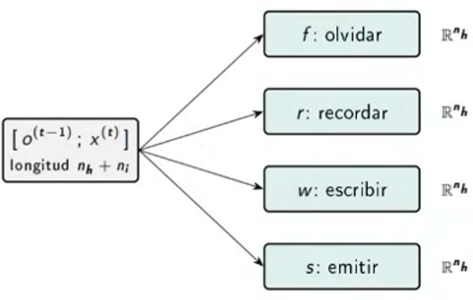
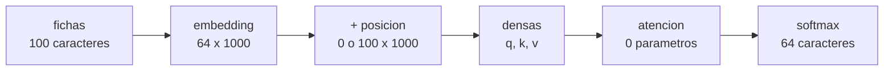

# Ejercicio 8.6

**Enunciado.**  
En el Ejemplo 8.11, la red LSTM se basaba en caracteres y tenía aproximadamente 3.5 millones de parámetros.

• (a) ¿Cuántos parámetros habría en una LSTM si se basara en palabras con un
vocabulario de 1,000 palabras y un estado oculto de tamaño 1,000?

• (b) ¿Cuántos parámetros habría si el vocabulario tuviera 10,000 palabras y el estado
oculto fuera de tamaño 10,000?

• (c) Considera un transformer simple basado en caracteres con un único mecanismo
de atención que realiza auto-atención (self-attention) para predecir el siguiente carácter en un texto. Supongamos que el tamaño de la ventana es 100, el tamaño del embedding es 1,000 y hay 64 caracteres. Supongamos que, como parte del transformer, hay funciones densas para q, k y v como entradas al mecanismo de atención, y la salida de la atención va directamente a un softmax. ¿Cuántos parámetros hay?

• (d) Supongamos que en lugar del transformer basado en caracteres en (c), el
transformer se basara en palabras, con un vocabulario de 10,000 palabras. ¿Cuántos parámetros hay?

## Respuesta

El numero de parametros estaria dado por $(n_{in} + 1)n_{out}$.  
El LSTM casi todo se encuentra en la memoria.  
Donde viven: en (b), $89%$ en la celda, en (d), $91%$ en embedding y salida.  
En (b) contra (d) no es justa: estado de 10,000 contra embedding de 1000. Una LSTM con $n_{h} = 1000$ y $V = 10,000 : 54,014,000$.  
La ventana que se tiene es gratis en cuanto a parametros, no asi en memoria: r es de $W\times W$.

## Desarrollo

Recordatorio:

¿Que es un parametro?  
Es un numero que la red ajusta cuando entrena. Pensarlo como un perilla de una consola de sonido: entrenar seria girar la perilla hasta que se tenga un buen sonido.

Ejemplo: la red XOR

$
W = \begin{pmatrix}
  1 & -1 \\
  -1 & 1 
  \end{pmatrix} ...(4)
$,
$
b = \begin{pmatrix}
  0 \\
  0
  \end{pmatrix} ...(2)
$,
$
v = \begin{pmatrix}
  10 \\
  10
  \end{pmatrix} ...(2)
$,
$c = -5  ...(1)$

tenemos: $4 + 2 + 2 + 1 = 9$ parametros.

por lo que contar parametros es como contar perillas, mas perillas: mas capacidad y tambien mas datos y mas memoria para entrenar.

Funcion lineal densa de $n_{in}$ entradas a $n_{out}$ salidas (libro, seccion 8.1)

$(n_{in} + 1)n_{out}$ parametros

- Un peso por cada par entrada-salida, mas un sesgo por salida.
- Activaciones, softmax y la atencion misma (r, p, c): cero parametros.
- Embedding de un vocabulario V en dimsesion $d: V \times d$ (sin sesgo).

Ejemplo: la capa oculta del XOR va de 2 a 2: $(2 + 1) \times 2 = 6$, que son los 4 pesos de W y los 2 sesgos de b.

Cada una: $(n_{k} + n_{i} + 1)n_{k}$  
Las sigmoides, la tanh y los productos punto a punto: sin parametros.

se tiene $ #LSTM = 4(1 + n_{h} + n_{i})n_{k}$ (la celda recurrente)

- La celda produce un vector de n\_{h} numeros.
- Para una distribucion sobre V palabras hace falta una densa de n*{h} a V y un softmax: $(n*{h} + 1)V$ parametros mas.
- El material no la cuenta en (a), (b), pero si en (c) y (d).

Convenio  
Contamos el modelo completo en todos los incisos, y damos tambien la celda sola.

Tenemos que:

(a)

|                                   | $n = 10^3$ |
| --------------------------------- | ---------- |
| Celda $4(1 + n_{h} + n_{i})n_{h}$ | 8,004,000  |
| Salida $(n_{h} + 1)V$             | 1,001,000  |
| Total                             | 9 005 000  |

(b)

|                                   | $n = 10^4$  |
| --------------------------------- | ----------- |
| Celda $4(1 + n_{h} + n_{i})n_{h}$ | 800,040,000 |
| Salida $(n_{h} + 1)V$             | 100,010,000 |
| Total                             | 900,050,000 |

Si $n_{i} = n_{h} = V = n$: celda $8n^2 4n$, salida $n^2 + n$,

$N_{LSTM}(n) = 9n^2 + 5n$.

Multiplicar n por 10 multiplica los parametros por casi 100: **_crecimeinto cuadratico_**.

¿Que hace el transformer?

Cada caracter de la ventana ve a los demas y decide a cuales hacerles caso.

- q (consulta): lo que cada caracter busca.
- k (clave): lo que cada caracter ofrece.
- v (valor): lo que cada caracter entrega si le hacen caso.

La atencion compara el q de uno con el k de todos, lo convierte en porcentajes con softmax y mezcla los v. Esas comparaciones no tienen entrenamiento, el entrenamiento esta en las densas que producen q, k y v.

Funcionamiento del transformer

- Posicion. El libro la suma al embedding y dice que puede aprenderse o fijarse. Si se aprende: $100 \times 1000 = 100,000$. Es el unico lugar donde entra la ventana.
- q y k de 1000 a 1000 (supuesto: $d_{k} = 1000$): $1001 \times 1000 = 1,001,000$ cada una.
- La atencion $r = qk^T, p = softmax, c = pv: cero$.

Lecturas:

| Estandar(E)                                                                    |
| ------------------------------------------------------------------------------ |
| $v: 1000 \rightarrow 1000$ y luego una densa de 1000 a 64: $1,001,00 + 64064$. |

| Literal (L)                                                                                                                                                                 |
| --------------------------------------------------------------------------------------------------------------------------------------------------------------------------- |
| No hay densa entre la atencion y el softmax. Como el softmax es sobre 64 caracteres, $c = pv$ debe tener 64 componentes: $v : 1000 \rightarrow 64, 1001 \times 64 = 64,064$ |

Realizando calculos

(c)

| Pieza                  | V = 64 (E) | V = 64 (L) |
| ---------------------- | ---------- | ---------- |
| Embedding $V \times d$ | 64,000     | 64,000     |
| q y k                  | 2,002,000  | 2,002,000  |
| v                      | 1,001,000  | 64,064     |
| Densa de salida        | 64,064     | --         |
| Total                  | 3,131,064  | 2,130,064  |

(d)

| Pieza                  | V = 10,000 (E) | V = 10,000 (L) |
| ---------------------- | -------------- | -------------- |
| Embedding $V \times d$ | 10,000,000     | 10,000,000     |
| q y k                  | 2,002,000      | 2,002,000      |
| v                      | 1,001,000      | 10,010,000     |
| Densa de salida        | 10,010,000     | --             |
| Total                  | 23,013,000     | 22,012,000     |

- +100,000 en cualquier columna si la posicion se aprende.
- Sin sesgos, E da 3,128,000 y 23,000,000: los numeros del material.

## Referencias

- Poole, D. L., y Mackworth, A. K. (2023). _Artificial Intelligence: Foundations of Computational Agents_, 3a. ed.
