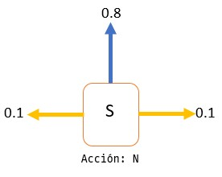
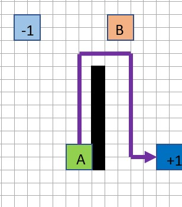
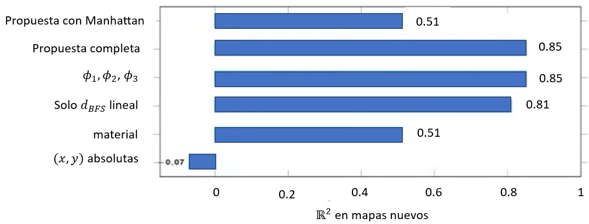

# Ejercicio 8

**Enunciado.**
Diseña características adecuadas para el aprendizaje por refuerzo en mundos de rejilla estocásticos (generalizaciones del mundo de $4 \times 3$ que contengan múltiples obstáculos y múltiples estados terminales con recompensas de $+1$ o $-1$).

## Respuesta

- las coordenadas deben ser relativas al mapa, no coordenadas.
- La forma importa: en el caso determinista $U^* = 1 + Rd$, exactamente lineal en la distancia por camino.
- En esta dinamica los muros no son peligro, el -1 de al lado si.
- En un modelo lineal, una caracteristica que es suma de otras no aporta nada.

La caracteristica buena la forma de la funcion que se quiere aproximar.

## Desarrollo

Recordatorio:

Una caracteristica es un numero que resume la situacion del agente. El agente apende un peso para cada una.

Buenas caracteristicas: con solo sumas y multiplicaciones se predice que tan buena es cada casilla. El agente aprende un peso para cada caracteristica y la suma.

La dinamica

ejemplo: (funcionamiento del algoritmo)

0.8 en la direccion elegida, 0.1 en cada perpendicular.
Si choca con el borde o un obstaculo se queda en su casilla.
$R = -0.04$ por paso no terminal, $\gamma = 1$.

$U^*(s) = R + max_{a}\Sigma_{s´}P(s´ | s,a)U^*(s´)$

La utilidad es lineal en la distancia por camino

**Proposicion**:  
Determinista, $R < 0$, +1 alcanzable y $d(s) < 2 / |R|$. Entonces $U^*(s) = 1 + Rd(s)$, con $d(s) =$ pasos minimos por casillas libres (BFS).

- Un camino de n pasos da $nR + 1$; lo mejor es el mas corto, $n = d(s)$.
- Obrener un -1 da a lo mas -1; conviene menos si $d(s) < 2 / |R| = 50$.

| Consecuencia 1                                        |
| ----------------------------------------------------- |
| Lineal en $d$, no en $1 / d$ como propone el material |

| Consecuencia 2                           |
| ---------------------------------------- |
| Distancia por camino (BFS), no Manhattan |

se tiene que cada paso cuesta lo mismo, es decir, si estamos a 5 pasos, cuesta 5 veces. Esto es por que se tiene una recta y no una curva.

Como contraejemplo (Manhattan)  
Manhattan dice que A es mas cerca del +1. A vale menos de la mitad que B.

|     | Manhattan | Camino | $U^*$ |
| --- | --------- | ------ | ----- |
| A   | 4         | 14     | 0,266 |
| B   | 8         | 8      | 0,606 |

Los muros protejen, lo peligroso son los pozos (-1). Lo peligroso es un -1 al lado, perpendicular a la direccion de movimiento. Lo mas conveniente es chocar con un muro.

**_Propuesta_**

Para prediccon:

$\phi _{1}(s) = d_{BFS}(s, T_{+})$ camino real al +1 mas cercano.  
$\phi _{2}(s) = min\lbrace d_{BFS}(s, T\_), 6 \rbrace$ un pozo lejano no importa.  
$\phi _{3}(s) = \# vecinos -1$ riesgo de resbalon  
$\phi _{4}(s) = \# lados bloqueados$ opcional

Para Q-learning (dependen de la accion):

$\psi _{1}(s, a) = \Sigma _{s´} P(s´ | s,a)d_{BFS}(s´, T_{+})$  
$\psi _{2}(s, a) = P(caer en T\_ | s,a) = 0.8 \times [adelante \in T\_] + 0,1 \times [lados \in T\_]$

Evidencia: generalizacion a mapas nuevos

Simulacion: mapas de $10 \times 10$, 14 obstaculos, dos +1 y tres -1. Se ajusta en 40 mapas y se evalua en otros 40.

La mayor ganacia: distancia por camino, en forma lineal. Los muros no aportan.

por tanto:

- las coordenadas deben ser relativas al mapa, no coordenadas.
- La forma importa: en el caso determinista $U^* = 1 + Rd$, exactamente lineal en la distancia por camino.
- En esta dinamica los muros no son peligro, el -1 de al lado si.
- En un modelo lineal, una caracteristica que es suma de otras no aporta nada.

La caracteristica buena la forma de la funcion que se quiere aproximar.

## Referencias

- Russell, S. J., & Norvig, P. (2021). _Artificial Intelligence: A modern approach_, 4th ed., Pearson.
